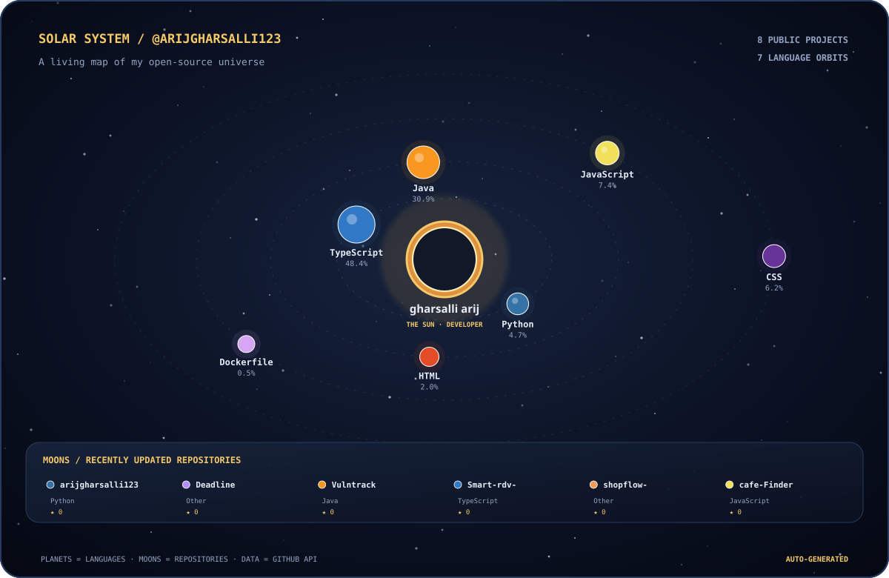

# Arij Gharsalli

Final-year Software Engineering and Information Systems student · Full-Stack Development · AI

## 🌌 My GitHub Solar System

  <i>Languages are planets · Repositories are moons · Recent projects orbit around the sun.</i>

  

## About me

I'm a final-year Software Engineering and Information Systems student at the University of Monastir, Tunisia. I enjoy building web and mobile applications, developing backend services, and exploring AI-powered software.

## Focus areas

- Full-Stack Web & Mobile Development
- Java, Spring Boot and REST APIs
- Artificial Intelligence and Machine Learning
- Databases, Cloud Computing and DevOps

## Connect

- [GitHub](https://github.com/arijgharsalli123)
- [LinkedIn](https://www.linkedin.com/in/arij-gharsalli-331150432/)

---

*The Solar System graphic is generated from public GitHub repository and language data using GitHub Actions.*
